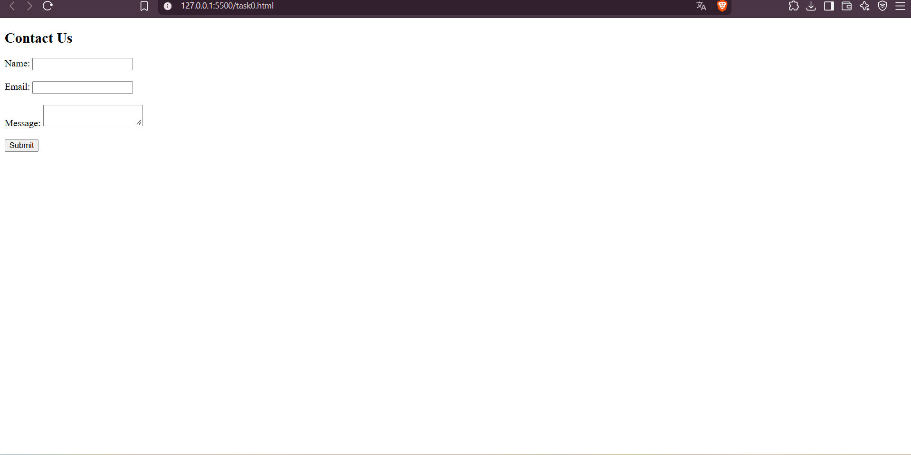
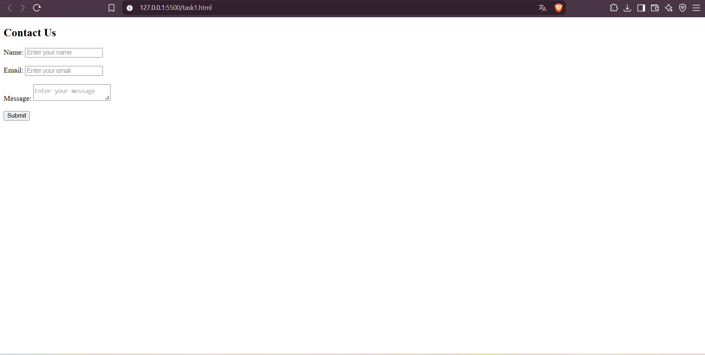
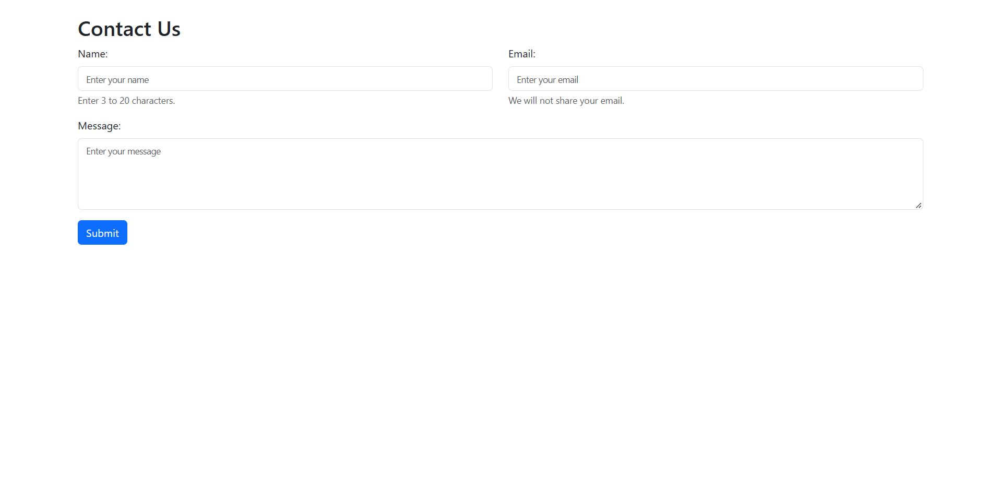
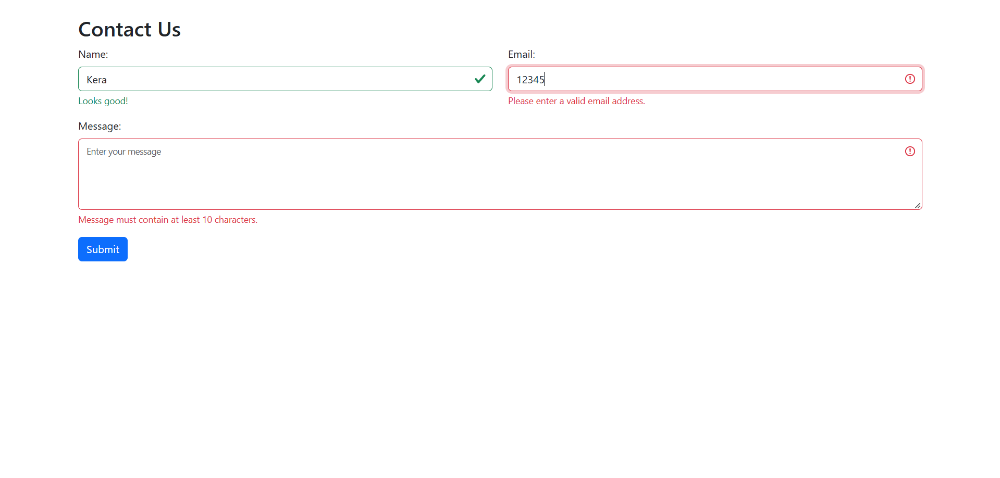
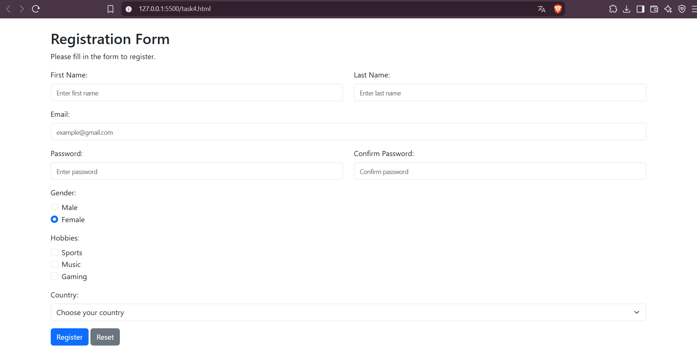

# Assignment 4 - Forms and Validation

## Student Information
- Name: Ainabek Chingiskhan
- Group: IT-2502

## Objective
The purpose of this assignment is to create HTML forms,
use HTML5 validation, and style forms using Bootstrap 5.

## Part 1: Basic HTML Forms

### Task 0 - Simple Contact Form
Created a contact form with Name, Email, Message,
and Submit button.

### Task 1 - HTML5 Validation
Added required fields, minlength, maxlength,
and email validation.

## Part 2: Bootstrap Forms

### Task 2 - Bootstrap Form Styling
Styled the contact form using Bootstrap 5.
Used form-control, form-label, and Bootstrap Grid.

### Task 3 - Bootstrap Validation Styles
Added valid-feedback and invalid-feedback messages.
Implemented Bootstrap validation using JavaScript.

## Part 3: Advanced Form Project

### Task 4 - Registration Form
Created a responsive registration form including:
- First Name and Last Name
- Email
- Password and Confirm Password
- Gender
- Hobbies
- Country
- Submit and Reset buttons

Implemented HTML5 validation and Bootstrap feedback.
Used JavaScript to check matching passwords.

## Work Summary
I created five HTML forms and practiced HTML5 validation,
Bootstrap styling, responsive layouts, and JavaScript.
I tested required fields, email validation, password
confirmation, and form feedback.
